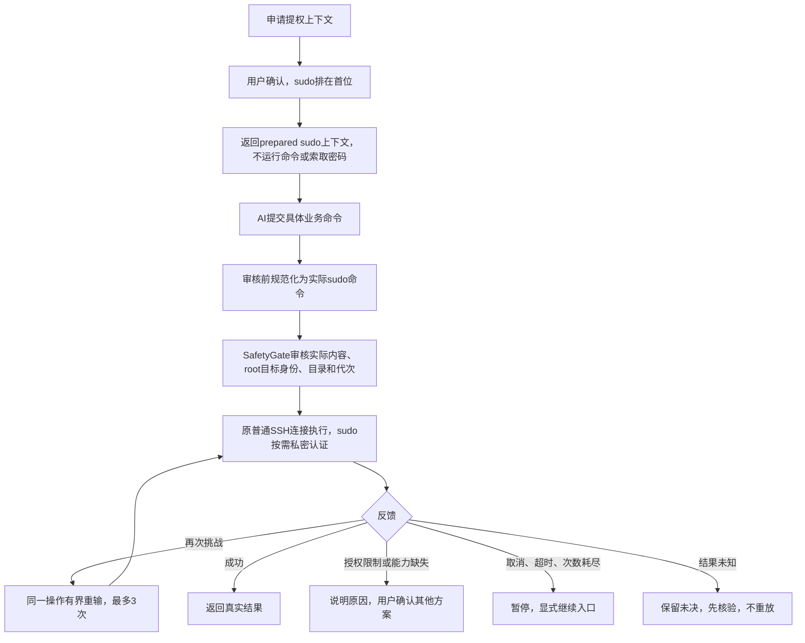

# 受控提权：默认 sudo 与结构化反馈

## 用户可见流程

`request_root_session`保留工具名及历史兼容，显示为“申请受控提权上下文”。默认推荐sudo；root SSH、直接su只是用户明确确认的备选，不自动尝试。

- 默认sudo不等于自动批准；申请时的command只是用途说明，不会执行，也不运行sudo -l/-v/-n true探测。
- sudo上下文返回`method=sudo,state=prepared,loginAs,targetRunAs=root,identityVerified=false`，不是已经登录root。每条命令在审核前规范化为`sudo -- <literal command>`；已有合法的root sudo命令不重复包装。
- 不启动sudo bash、sudo su或sudo Python通用root代理。仅允许单条字面命令；复杂命令链、展开、管道、重定向、其他目标用户、嵌套认证及权限探测在该上下文中拒绝。
- 目录仍必须可由登录用户访问，不悄悄更改cwd或使用额外root Shell；需要访问/root下文件时可从可访问目录使用绝对路径。
- sudo/su不提供结构化文件事务；文件需沿普通账户非秘密暂存、受审核安装等既有流程，或用户明确确认root SSH。不会无声降级成其他身份。

## 认证与恢复

- sudo通过现有操作专属askpass socket收集输入，不进入业务stdin、模型、审计正文或诊断。
- 第2次及以后的弹窗明确显示再次认证及次数，不仅凭再次挑战就断言密码错误；通常使用登录账户密码，但sudo/PAM可以有特殊配置。
- 新旧主机默认禁用应用缓存。用户先明确启用单密码自动复用，首次输入仍须声明可缓存；仅一次挑战且成功才保存。绑定任务、登录/目标身份、主机、认证方式、完整提示、连接与终端代次、策略版本，最多5分钟且不滑动续期。第二挑战、提示变化、失败、取消、未知、暂停、断线与任务结束均清除。标准askpass只有提示文本，不能证明服务器未改变PAM挑战类型。
- 每个单sudo操作最多3次挑战（包含缓存尝试），超时/取消/失效/晚到回答不会变成业务输入。到达上限就暂停，不能靠AI重开工具自动清零。
- root SSH沿已选择认证方式建立独立连接，并重新验证主机身份；直接su弹窗明确说明通常需要root密码，不是登录账户的sudo密码。
- 备选模式仍须验证root通道及`id -u`结果，成功才登记为已确认root会话；sudo prepared上下文不进入已确认root会话列表。
- 认证停止提供明确resumeReason和继续入口，但不会自动换身份、刷新请求预算或重放成功操作。产品SafetyGate拒绝不能通过其他身份绕过。

## 结构化反馈与证据边界

操作可带`privilege`元数据：`method/stage/code/source/businessCommand/recovery`。本地日志只增加有界错误码，不记录密码或原始认证正文。

| code | 含义与处理 |
| --- | --- |
| authentication-required | 需要当前操作的私密认证 |
| authentication-rejected | 观察到认证拒绝；不等于已证明哪项密码错误 |
| authentication-unconfirmed | 认证未完成、PAM/协议不兼容或无法确认原因 |
| authorization-denied | 观察到sudoers/命令授权限制，其他方案需用户确认 |
| sudo-unavailable | 固定执行组件确认sudo可执行程序不可用 |
| cancelled / timeout | 已取消、输入失效或等待超时 |
| attempts-exhausted | 当前操作认证次数已用尽 |
| transport-unavailable / unsupported | 通道中断或当前机制不支持 |

`source=output-inference`的sudo文本分类只是诊断推断：包括`-n`报告需要密码的分支，都不据此断言业务未执行，不把不在sudoers说成不在某个组，不把某条命令授权拒绝扩大成全账户不可用，不清除possible/unknown结果。只有固定传输组件能确认启动边界时才标`businessCommand=not-started`；先前步骤可能已执行时仍为unknown。

提权网络诊断仍保守处理：裸有界ping的规则不自动扩展到sudo ping；date/hostname的设置形式不分类为只读。自动批准范围不因sudo查询能力扩大。

当前会话和近期操作的有界事实直接从现有记录派生，包含来源ID、原登录/目标账户和版本；成功认证仅绑定该次操作，不创建全主机永久能力标志。没有用户配置或实际观察的权限保持未知，不主动做权限探测。

## 代码职责

- `packages/application/src/privileged-sessions.ts`：唯一会话授权状态，区分prepared与已验证ready，绑定任务/主机和撤销。
- `apps/desktop/src/worker/privileged-runtime.ts`：已有资源装配，连接/终端索引不是另一套授权状态；sudo复用普通执行器。
- `apps/desktop/src/worker/operation-input-bridge.ts`：复用私密认证、重输、凭据缓存及交互协调。
- `packages/core/src/sudo-outcome.ts`：唯一sudo结果解释入口；`privilege.ts`只定义安全反馈类型和文字，不另造认证分类器。
- `packages/adapters/src/ssh-command-terminal.ts`、`native/process/`：固定执行协议、启动前错误与私密认证事件。
- `packages/adapters/src/su-session.ts`、`native/su/`：su协议与有界错误码，保留密码/业务通道隔离。
- Renderer只展示后端元数据，不决定是否换身份、清锁或执行。

## 当前原生组件验收

本轮以真实 Linux CI 为准，详见 [TOOLS_REPAIR_STATUS.md](TOOLS_REPAIR_STATUS.md)。普通命令按 Bash source 执行，独立命令不共享 shell 状态。支持的 sudo 前台步骤保留目标 executable/argv 与精确 sudoers 匹配，不能替换为 `sudo helper --run`。复合操作在审核前显示各步骤实际目标；supervisor UID 与 sudo 业务进程 UID 不混同。root SSH/su 仅在独立通道和 UID 核验后激活。

## 旧实现历史证据（不作为本轮验收）

自动门禁使用本地SSE、内存/临时数据库、合成认证输入和协议fixture，不连接用户主机、不调用真实模型，不读取日常AppData或凭据。`b53c2bcab`完整复核退出0：139文件1400测试通过、7文件19项原条件跳过；typecheck、ESLint、依赖方向、800行、版本/CHANGELOG、Edge UI、Markdown、隔离Windows Electron装配及diff通过。`b2066ba92`构建、静态及6项恢复/提权原生链通过。之前一次旧恢复夹具初始化0请求在隔离和全量复跑均未复现，原因未确认，未降低断言/超时或修改生产重试。

用户后续单独授权本地虚拟机SSH只读sudo身份验证；使用独立临时Electron用户目录、本地SSE代替真实模型，密码由用户在产品私密UI输入，不写脚本/命令行/日志。已确认隔离验证能完成SSH登录；`bddc1b865`复测元数据确认：固定Python环境预检返回127，并出现not-found类提示，操作为unsupported/effects=none，业务sudo尚未启动、未取得UID0。这只说明本次SSH执行环境的预检失败，不证明虚拟机完全没安装Python，也可能涉及非交互PATH或测试环境限制。用户已选择先交付本地验收通过的代码，VM部分交由手动核验，不计提权验证通过，不猜成root密码错误，也不自动更换身份。Windows不能运行的POSIX/PTY fixture仍按原条件跳过；这也不等于已验证所有PAM、sudoers、root SSH禁用及发行版差异。新增认证暂停会明确提供继续原因；本次不批量改写旧对话的暂停记录，旧对话仍可通过明确发送下一步消息继续。

## 旧实现历史核验步骤（Python步骤已被原生组件取代）

1. **远端运行环境**：在VM控制台确认`command -v python3`、`python3 --version`；若交互终端可用而应用失败，再核对非交互SSH中的PATH/运行环境。不要只据本次自动化失败就断言需要重装Python。
2. **默认sudo真实链路**：在应用选择测试VM，发送“申请默认sudo提权上下文，目录用 /，然后仅执行id -u验证身份。不要使用root SSH或直接su，不修改文件”。应优先显示sudo；上下文prepared不声称已登录root；实际审核/终端显示`sudo -- id -u`，成功后才依据UID0作本次操作结论。
3. **私密认证**：密码只在认证框输入，不发聊天、不放命令行。需要认证时应使用sudo自身要求的凭据，而非引导设置root密码。免密sudo没有弹窗是正常结果。
4. **重输/取消**：只有确认本地VM锁定策略允许时才做错误输入测试；同一操作有界再次询问，取消/耗尽后暂停、提供显式继续入口，不自动换身份或重放。不要为测拒绝而修改现有sudoers，可使用另行准备的受限测试账户。
5. **真实模型与兼容性**：真实模型是否稳定默认选sudo、实际PAM/额外认证、root SSH禁用、发行版差异和本地POSIX/PTY跳过项仍未验收；1400项本地通过不代表这些已经通过。

回传信息只需操作ID、退出码、是否出现UID0及脱敏后的错误类别，不要提供密码、验证码或完整私有日志。
